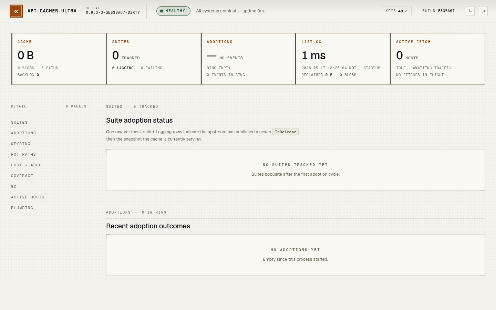

# apt-cacher-ultra

A robust apt repository cache focused on availability under upstream failure.

Designed as a replacement for `apt-cacher-ng` that keeps cache hits
available even when upstream Ubuntu/Debian/PPA mirrors are slow, broken,
or under DDoS.  It snapshots repo updates, tracks "hot packages" across your
fleet, and pre-downloads hot packages before making snapshot updates available
for clients to request.  This provides the ability to reliably provide package
sets to clients even if upstream servers become unavailable.  The limitation is
that "cold" packages require upstream availability.  Typical usage should be
available from the cache at all times.

> **Contributing:** apt-cacher-ultra accepts AI-authored contributions only.
> See [CONTRIBUTING.md](CONTRIBUTING.md) for more details.



## Status

Stable 1.0 release.  I run it in my 4 environments with 200 machines, serving thousands
of "apt update/upgrade" and "apt installs".

## Features

- Drop-in apt-cacher-ng replacement — same :3142 port, proxy mode, and http://HTTPS/// URL convention, so existing
client configs work unchanged.
- TLS MITM (optional) — local CA signs per-host leaf certs so HTTPS repos (e.g. download.docker.com) can be cached,
- Availability-first caching — cache hits never block on upstream; snapshot is served when upstream is down/slow
  rather than failing.
- Atomic snapshot adoption — per-suite InRelease + all referenced Packages/by-hash blobs are staged, GPG-verified
  (signed repositories; see [Repositories](#repositories)), and flipped in a single SQLite transaction. The flip
  waits (bounded) until clients that received the old InRelease have had `adoption.flip_quiet_period` to fetch its
  indexes, so the index requests an apt client sends within that period
  of its InRelease match it (by-hash requests are served from the displaced snapshot even later); the residuals (a
  client whose old InRelease is still being sent 15 s into a hold, or finished less than `flip_quiet_period` before then, a commit slower than the 20 s hold, a switch that waits
  60 s for its turn to hold, responses slower than apt's own timeout, more than 256 held requests) each have a
  counter and are documented in [Flip consistency](docs/configuration.md#flip-consistency).
- Hash validation — every metadata file is checked against InRelease, every .deb against Packages (signed
  repositories; see [Repositories](#repositories)); mismatches are rejected.
- by-hash dedup — indices stored by content hash, deduplicated across suites.
- Singleflight coalescing — N concurrent clients requesting the same uncached file produce one upstream fetch.
- Resumable upstream fetches — HTTP Range used to resume on transient failure.
gated by an allowed-host regex.
- Freshness control — periodic and on-request InRelease checks with cooldown; hot-package proactive refresh.
- Flat, unsigned and Release-less repositories — refreshed like `dists/` repositories, with adoption enabled (see
  [Repositories](#repositories)).
- Concurrency caps — per-host and global max_concurrent_adoptions semaphores keep adoption traffic from starving
request-path callers.
- Garbage collection — refcounted blobs are swept when no snapshot references them.
- Suite reaping — a suite no client has asked for in 30 days is dropped with its cached index files (see
  [Suites no client uses](#suites-no-client-uses)).
- Self-healing snapshots — a snapshot adopted while a required index was briefly unavailable is repaired in place,
  automatically on the next unchanged freshness check or on demand via `POST /reconcile` (see "Recovering a degraded
  repository").
- Observability — /metrics endpoint, status page, structured logs (see docs/log-fields.md).
- Packaging — install from the [apt repository](https://linsomniac.github.io/apt-cacher-ultra/), the `.deb` with systemd unit, or the standalone Go executable.

## Quickstart

### Install from the apt repository (recommended):

```sh
sudo install -d -m0755 /etc/apt/keyrings
curl -fsSL https://linsomniac.github.io/apt-cacher-ultra/apt-cacher-ultra.gpg \
  | sudo tee /etc/apt/keyrings/apt-cacher-ultra.gpg >/dev/null
sudo chmod a+r /etc/apt/keyrings/apt-cacher-ultra.gpg  # apt verifies as the _apt user; the key must be world-readable
echo 'deb [signed-by=/etc/apt/keyrings/apt-cacher-ultra.gpg] https://linsomniac.github.io/apt-cacher-ultra/ stable main' \
  | sudo tee /etc/apt/sources.list.d/apt-cacher-ultra.list
sudo apt-get update
sudo apt-get install apt-cacher-ultra
#  EDIT: /etc/apt-cacher-ultra/config.toml
sudo systemctl enable --now apt-cacher-ultra
```

Prebuilt `amd64` packages are published to
<https://linsomniac.github.io/apt-cacher-ultra/> (newest stable releases).

### As Deb Package:

```sh
make deb
dpkg -i build/apt-cacher-ultra_*.deb
#  EDIT: /etc/apt-cacher-ultra/config.toml
sudo systemctl enable --now apt-cacher-ultra
systemctl start apt-cacher-ultra
#  allow 3142 through firewall if necessary:
iptables -I INPUT -p tcp --dport 3142 -j ACCEPT
```
### Manual build:

```sh
make build
cp packaging/config/config.toml.default config.toml
#  EDIT: config.toml
./build/apt-cacher-ultra -config config.toml
```

## Configuration

Edit `/etc/apt-cacher-ultra/config.toml` (or the file passed to `-config`),
then restart the daemon. The [configuration reference](docs/configuration.md)
documents every option, its defaults, valid values, and interactions. The
[packaged example](packaging/config/config.toml.default) includes every option
with concise comments and optional signer, remap, and mirror examples.

The packaged configuration listens on `0.0.0.0:3142`, allows all upstreams,
and enables HTTPS MITM;
[HTTPS proxy clients must trust the cache's CA](#configure-the-mitm-https-proxy-optional).
Snapshot adoption is initially disabled. The admin interface, including
`POST /reconcile` and `POST /forget`, listens on `127.0.0.1:6789`. Review
these settings before making either listener available beyond your trusted
network.

To fetch through another proxy, set `proxy = "http://proxy.example.net:3128"`
in `[upstream]`. Direct access remains the default. See
[upstream proxy setup](docs/configuration.md#using-an-upstream-proxy) for
authentication, HTTPS, and access-policy requirements.

For maintainers, [documentation publishing options](docs/documentation-hosting.md)
compares hosting the docs alongside the apt repository, on a separate Pages
site, or on an existing server.

### Configure apt clients:

Point clients at it as a proxy (matches existing apt-cacher-ng deployments)
by creating the following file with these contents:

```
# /etc/apt/apt.conf.d/00aptcacher
Acquire::http::Proxy "http://APT_CACHER_ULTRA_HOSTNAME:3142";
Acquire::https::Proxy "DIRECT";
```

The explicit `DIRECT` keeps HTTPS uncached until you configure MITM below.
APT inherits HTTP options for HTTPS when their HTTPS counterparts are unset;
see [APT HTTPS options](https://manpages.debian.org/unstable/apt/apt-transport-https.1.en.html#OPTIONS).

For apt repositories using **https**, pick one of these (the cache allows all
upstream hosts by default, so no allowlist editing is needed):

- **https, not cached** — leave the sources as `https://` and set
  `Acquire::https::Proxy "DIRECT";`. apt connects directly to the upstream
  over TLS. Pointing HTTPS at the cache while MITM is off produces a `405`
  response to `CONNECT` and apt fails.
- **https, cached, no MITM** — rewrite each source from `https://HOST/path`
  to `http://HTTPS///HOST/path` (the apt-cacher-ng convention). The
  client↔cache hop is plain http through the proxy above; the cache fetches
  the upstream over https and caches the result. No CA setup required.
- **https, cached, with MITM** — keep the sources as `https://`, configure
  the MITM proxy, and install its CA on each client (see the next section).

### Configure the MITM HTTPS proxy (optional):

MITM is enabled by default. It decrypts, caches, and re-serves HTTPS sources
by signing per-host leaf certificates from a local CA. Clients using
`Acquire::https::Proxy` must trust that CA. Setting `tls_mitm.enabled = false`
rejects `CONNECT` with `405`; apt does not automatically fall back to a direct
connection. To access HTTPS repositories directly, explicitly set
`Acquire::https::Proxy "DIRECT";`.

1. Edit the existing `[tls_mitm]` block in `config.toml` (add it if absent):

   ```toml
   [tls_mitm]
   enabled            = true
   # allowed_host_regex lists the hosts MITM may sign certs for. It is
   # translated into the CA's X.509 NameConstraints, so it accepts only a
   # restricted grammar (see the table below). This example covers the
   # Debian repos plus Docker:
   allowed_host_regex = '^(deb\.debian\.org|security\.debian\.org|download\.docker\.com)$'
   allow_unconstrained_ca = false
   # ca_cert / ca_key empty = auto-generate under <cache.dir>/ca on first start.
   ```

   **Supported `allowed_host_regex` shapes** (anchors `^…$` optional but must
   be balanced). When generating a new CA, anything else is refused with
   `mitm_ca_unconstrained_refused` if `allow_unconstrained_ca = false`:

   | Shape | Example |
   |-------|---------|
   | literal host | `^deb\.debian\.org$` |
   | single-label prefix (note `+`, not `*`) | `^[a-z0-9-]+\.debian\.org$` |
   | optional 2-letter region | `^([a-z]{2}\.)?archive\.ubuntu\.com$` |
   | alternation of **literal** hosts | `^(deb\.debian\.org\|security\.debian\.org)$` |

   `*` quantifiers and alternations with non-literal branches (e.g. the
   `^([a-z0-9-]+\.)*(ubuntu\.com|debian\.org)$` form) are **not** supported.
   To MITM-sign for **all** hosts instead (no name constraints — convenient,
   but the CA can then mint a cert for any name), use:

   ```toml
   [tls_mitm]
   enabled                = true
   allowed_host_regex     = ''
   allow_unconstrained_ca = true
   ```

   These generation settings apply when creating a CA. An existing CA is
   reused; changing the regex does not replace its name constraints. See
   [CA reuse and policy changes](docs/configuration.md#ca-reuse-and-policy-changes).

2. Start the daemon once so the CA is materialized, then export it:

   ```sh
   sudo systemctl restart apt-cacher-ultra
   sudo apt-cacher-ultra ca print > apt-cacher-ultra-ca.crt
   ```

3. Install the CA **certificate** on every apt client; keep the private key
   on the cache host. Choose one of:

   a. Install the CA and refresh the system-wide trust store:

      ```sh
      sudo cp apt-cacher-ultra-ca.crt /usr/local/share/ca-certificates/
      sudo update-ca-certificates
      ```

   b. Place the CA cert and configure apt (and only apt) to use it:

      ```sh
      sudo cp apt-cacher-ultra-ca.crt /etc/ssl/certs/
      ```

      Then in an `/etc/apt/apt.conf.d` file:

      ```
      # /etc/apt/apt.conf.d/00aptcacher
      Acquire::http::Proxy "http://APT_CACHER_ULTRA_HOSTNAME:3142";
      Acquire::https::Proxy "http://APT_CACHER_ULTRA_HOSTNAME:3142";
      Acquire::https::CaInfo "/etc/ssl/certs/apt-cacher-ultra-ca.crt";
      ```

4. Set `cache.advertise_host` to the cache's client-facing hostname or
   host:port if `cache.listen` uses a wildcard address such as `0.0.0.0`.
   Generate the client apt-conf snippet (includes both proxy settings and
   the CA fingerprint as a comment for verification):

   ```sh
   # Run on the cache host:
   sudo apt-cacher-ultra --print-apt-conf -config /etc/apt-cacher-ultra/config.toml \
       > 00aptcacher.generated
   ```

   Copy the generated file to each client, then install it there with
   `sudo install -m 0644 00aptcacher.generated /etc/apt/apt.conf.d/00aptcacher`.
   If using apt-only CA trust from step 3b, retain the
   `Acquire::https::CaInfo` line when installing the generated snippet.
   `--print-apt-conf` emits an HTTPS proxy line even when MITM is disabled;
   use it for this MITM setup, or replace its HTTPS proxy value with `DIRECT`
   for HTTP-only caching.

## Repositories

Snapshot adoption (`[adoption] enabled = true`, after loading the
repositories' signing keys on the cache host, in `/etc/apt/keyrings` or
`adoption.keyring_dirs`; restart after adding one) is what keeps metadata
fresh: the cache checks each repository its clients use and serves every
change as one coherent snapshot, adopted at the repository's first
`apt update` through the cache when an adoption slot is free. It is off
in the packaged configuration:
until you enable it, each metadata file is served as the cache first
stored it, and suites are only checked for changes.

- **`dists/` repositories** (Debian, Ubuntu, most vendors), signed with an
  `InRelease` or with `Release` and `Release.gpg`; a suite moves between
  the two forms by itself. `Release` files that list only SHA512 hashes
  are supported.
- **Flat repositories**, with no `dists/` tree, configured either way apt
  accepts: `deb https://pkgs.k8s.io/core:/stable:/v1.34/deb/ /` or
  `deb https://pkgs.k8s.io/core:/stable:/v1.34/deb ./`, and with a
  subdirectory, `deb https://pkg.jenkins.io/debian-stable binary/`. The
  `/` and `./` forms of one directory are tracked as two suites. A flat
  repository at the root of its host (`deb https://example.com/ ./`) is
  not supported: it is served from the cache but never refreshed, with a
  WARN `flat_host_root_unsupported`. A signed flat repository's key is
  often installed only on the clients (`signed-by=`): the cache host
  needs it too (unless `adoption.accept_any_signer = true` and no
  `[[trusted_signer]]` names the host), or its adoption fails
  (`gpg_failed`) and is retried.
- **Unsigned repositories** (a `Release` with no signature, for
  `[trusted=yes]` clients) are adopted as unsigned snapshots, served
  coherently but never trusted: they vouch for no package. A new one is
  adopted once two checks have seen the same `Release` at least 5 minutes
  apart (with the default `cooldown` and `periodic_refresh`, usually
  5 to 15 minutes after its first `apt update` through the cache; at least
  an hour when its host answers 401 or 403 for the missing signature
  file, as Amazon S3 does), and a repository the cache has seen signed is
  never adopted unsigned. Read the [threat
  notes](docs/configuration.md#anchor-forms-and-unsigned-repositories)
  before serving them; `adoption.adopt_unsigned = false` turns this off
  (and the refresh below).
- **Flat repositories that publish no `Release` at all** (Gemfury,
  goreleaser) are refreshed file by file: each cached index is
  revalidated with upstream, and an HTML page never replaces one.

The [configuration reference](docs/configuration.md) has the rules and
limits: [eager first adoption](docs/configuration.md#eager-first-adoption),
[flat repositories](docs/configuration.md#flat-repositories), and [strict
mode](docs/configuration.md#integrity-corruption-checks)
(`integrity.refuse_unvouched_debs`), which now protects flat hosts too.

## Inspecting the cache

Two read-only management subcommands let you see what's in the blob store
and pull a specific `.deb` back out without touching the daemon. Both
run safely while the daemon is live (SQLite WAL allows concurrent
readers).

```sh
# List every cached .deb (NAME / SIZE / AGE / HOST(S))
apt-cacher-ultra packages list -config /etc/apt-cacher-ultra/config.toml

# Filter by substring against the .deb filename
apt-cacher-ultra packages list -config /etc/apt-cacher-ultra/config.toml nginx

# Alternate output formats
apt-cacher-ultra packages list -format plain   # one filename per line
apt-cacher-ultra packages list -format json    # JSON array

# Copy a specific .deb out of the pool by exact filename.
# Destination may be a directory (file is named after the .deb) or a path.
apt-cacher-ultra packages copy -config /etc/apt-cacher-ultra/config.toml \
    nginx_1.18.0-1_amd64.deb /tmp/
```

## Recovering a degraded repository

If a suite was adopted while a required index was briefly unavailable upstream,
its snapshot can end up missing that index (for example
`dists/<suite>/main/binary-all/Packages`) and serve an authoritative `404` for
it — which shows up client-side as `apt update` failing to fetch that file.
apt-cacher-ultra heals such snapshots **in place** (no re-adoption, no serving
gap), two ways:

- **Automatically** — on a freshness check where the upstream `InRelease`
  is unchanged and an adoption slot is free (`max_concurrent_adoptions`; a
  check that finds none skips the heal until a later unchanged check), the
  daemon re-parses the snapshot's signed `Release`, fetches any
  declared-but-missing index, validates it, and inserts it into the live
  snapshot. Nothing to do; this is on by default (`[adoption].repair_skipped_members`).
- **On demand** — force an immediate reconcile of one suite through the admin
  listener (default `127.0.0.1:6789`; protect it with `admin.htpasswd_file`
  and/or the bind address). `host` and `suite` are the canonical host and suite
  path as they appear in the daemon's `adoption_success` / freshness logs;
  `scheme` is optional (default `https`). The request needs the header
  `X-ACU-Admin: 1` and, without `admin.htpasswd_file`, must name the listener
  by IP address, as `localhost` or by the host name in `admin.listen` (see
  [the admin listener's checks](docs/configuration.md#admin-status-metrics-and-maintenance)):

```sh
curl -sS -X POST http://127.0.0.1:6789/reconcile -H 'X-ACU-Admin: 1' \
    --data-urlencode 'host=packages.microsoft.com' \
    --data-urlencode 'suite=/ubuntu/24.04/prod/dists/noble'
# 202 Accepted = reconcile triggered (runs asynchronously)
# 400 = host or suite missing, a scheme other than http or https, a host
#       holding scheme:// (pass the scheme in scheme), or a body that is not a form
# 401 = admin.htpasswd_file is set and the credentials are missing or wrong
#       (add -u user)
# 403 = the header is missing, a browser request from another origin, or
#       another host name without admin.htpasswd_file
# 409 = busy, unknown suite, no current snapshot, or no free adoption slot
# 413 = a body over 8 KiB
```

The metric `acu_serve_snapshot_index_target_404_total` (and the
`snapshot_index_target_404` WARN log) is the signal that a client's `apt update`
is being denied a required index; `acu_adoption_reconciled_total` rises as the
suite heals.

## Suites no client uses

A suite no client has asked for in `gc.suite_idle_ttl` (30 days by
default) is reaped by a pass that runs every hour: it is no longer
tracked, its cached index files are deleted and its snapshots retired
(GC deletes them). Its packages stay cached, without the version
retention its snapshot gave them. A client that comes back makes it new
again, fetched from upstream. The pass runs whatever `gc.enabled` says.
An offline or archive cache that
must keep serving suites nobody asks for sets `suite_idle_ttl = "0s"` in
the `[gc]` section — before upgrading from 1.0, whose suites count as idle
from the last request before the upgrade ([Suite
reaping](docs/configuration.md#suite-reaping)); the `apt-cacher-ultra
starting` log line then shows `gc_suite_idle_ttl=0s`
(`"gc_suite_idle_ttl":0` with `log.format = "json"`; a key in another
section is ignored without a warning).

## Forgetting a suite

`POST /forget` reaps one suite at once, however recently it was used. It
is the way out of two refusal states the status page shows: a deliberate
upstream rollback (`refused: upstream_older` or `rollback_refused`) and a
vendor that stopped signing (`refused: unsigned_downgrade_refused`). The
next request makes the suite new again and, with adoption enabled, adopts
what upstream serves then (for `unsigned_downgrade_refused`, forget the
path's other suites too — its `/.` twin, or its copy under the other
scheme — or it is refused again). It takes the same header and host rules as
`POST /reconcile`; pass the scheme, host and suite path the status page
shows:

```sh
curl -sS -X POST http://127.0.0.1:6789/forget -H 'X-ACU-Admin: 1' \
    --data-urlencode 'scheme=https' \
    --data-urlencode 'host=packages.microsoft.com' \
    --data-urlencode 'suite=/ubuntu/24.04/prod/dists/noble'
# 202 Accepted = forgotten; the body names the suite, counts the
#                signed-seen markers (records that the path was seen
#                signed) it deleted, and names any suite that kept them
# 401 = admin.htpasswd_file is set and the credentials are missing or wrong
#       (add -u user)
# 409 = busy (try again) or no such suite
```

[Forgetting a suite](docs/configuration.md#forgetting-a-suite-post-forget)
lists its other answers and what forgetting deletes.

## Build

```sh
make build           # binary at ./build/apt-cacher-ultra
make test            # unit tests
make lint            # golangci-lint (must be installed)
make deb             # .deb package (nfpm must be installed)
make e2e-flat        # real apt against fixture repositories through the cache (Docker)
make e2e-live        # the manual smoke against live flat repositories (Docker, network)
make clean
```

For Linux targets, `make build` disables cgo and produces a statically linked
binary that can be copied from NixOS to Ubuntu without requiring the build host's
dynamic loader or glibc. The operating system and architecture must match the
destination; for Linux amd64 explicitly, use `GOOS=linux GOARCH=amd64 make build`.
Like the container build, this uses Go's DNS resolver. This also applies to
`make deb`; race-enabled tests keep cgo available.

`make e2e-flat` runs real apt clients — apt 2.2 to 3.2, on six Debian and
Ubuntu images — against fixtures of every supported repository layout
through the cache: about 25 minutes in sequence with cached image builds,
up to about 45 cold. CI runs one job per image; when CI's `e2e-flat` is
red, start at [Flake, environment or daemon
bug?](e2e/flat/README.md#flake-environment-or-daemon-bug). `make e2e-live`
checks the live repositories those fixtures copy, by hand before 1.1.0
and before later releases that change the request path, adoption or
vouching ([e2e/live](e2e/live/README.md)). A binary built with `-tags
e2ehooks` is a test binary and must never ship: CI and the release
workflow refuse one.

## License

Released into the public domain under [CC0 1.0 Universal](LICENSE).
